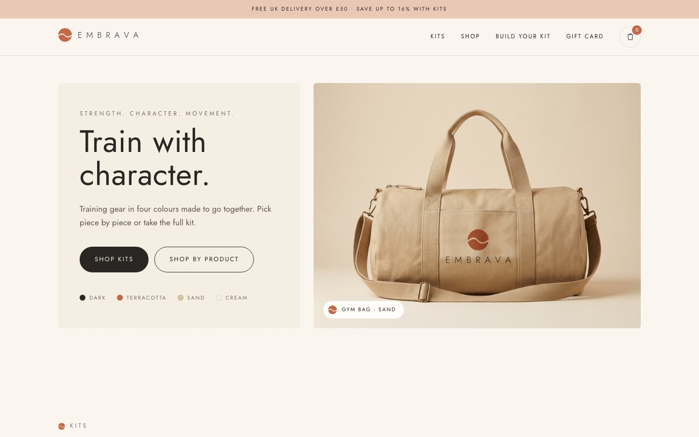

# Embrava · online store

Designed and built by [Andrea Martinez Moreno](https://github.com/andrea-mmo).

A concept e-commerce site for **Embrava**, a training gear brand built on four colours and a wave-shaped *m*.

**Live store:** https://andrea-mmo.github.io/embrava/
**Case study:** https://andrea-mmo.github.io/embrava/case-study.html



## Features

- Colour-first catalogue: swatches swap the product photo, and the chosen colour carries through to the product page and URL
- Kits that are always the best deal, plus a "build your own kit" picker with 15% off from three pieces
- Product pages with a colour gallery, kit offer, details and related pieces
- Persistent basket with quantity controls and a free delivery tracker
- Responsive down to small phones, with a sticky add-to-basket bar on mobile
- The original logo vectors are reused through one SVG sprite and never redrawn

## Built with

Plain HTML, CSS and JavaScript. No framework, no build step.

| File | Purpose |
|---|---|
| `index.html` | Homepage: hero, kits, shop, build your kit, gift card |
| `product.html` | Product page template (`product.html?p=bottle&colour=sand`) |
| `case-study.html` | Design case study |
| `data.js` | Catalogue: products, prices, kits and copy |
| `app.js` | Shared helpers, basket and homepage logic |
| `product.js` | Product page logic |

To run it locally, serve the folder with any static server, for example:

```bash
python3 -m http.server 4321
```

## Note

This is a concept project. Product images were generated with AI from the brand's own designs, prices are illustrative and checkout is disabled.
